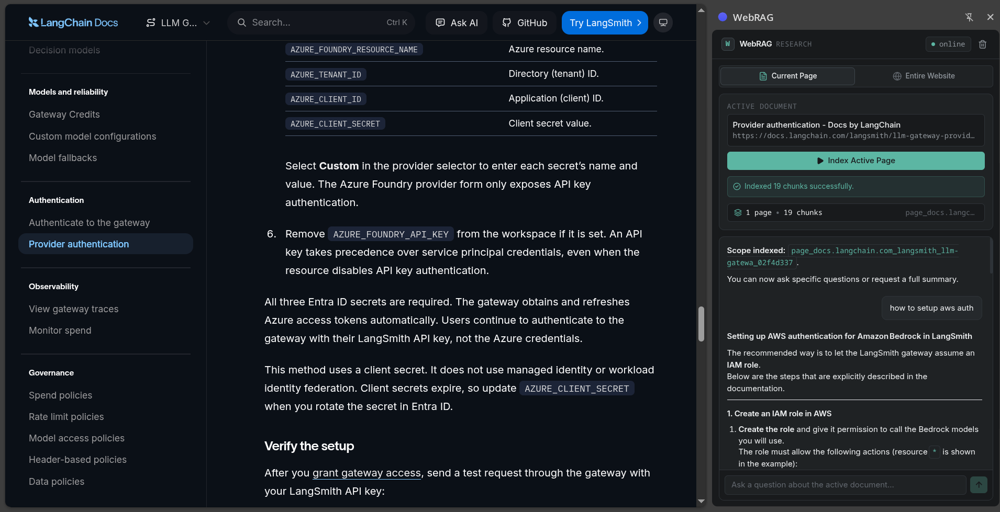
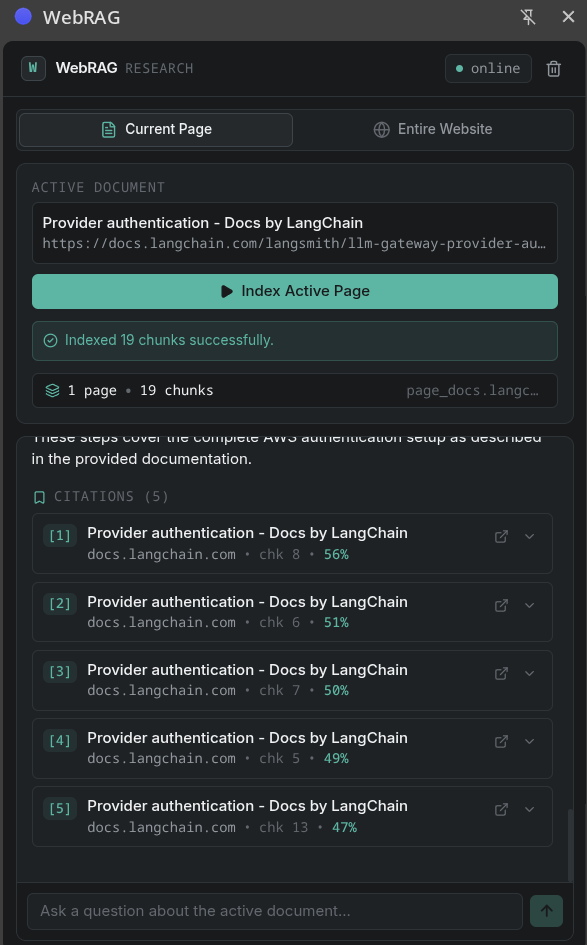
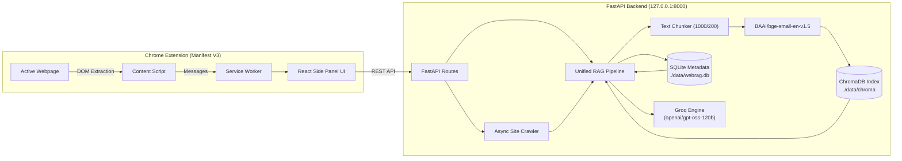

# WebRAG

> Browser-native website knowledge assistant powered by Retrieval-Augmented Generation (RAG).

WebRAG transforms arbitrary webpages and multi-page documentation websites into interactive, searchable knowledge bases. Using a Chrome Side Panel extension paired with a local FastAPI backend, users can index active browser tabs or crawl entire documentation hierarchies, ask natural-language questions, and receive factual answers grounded in retrieved evidence with clickable source citations.

---

## Table of Contents

- [Key Features](#key-features)
- [Screenshots](#screenshots)
- [Architecture](#architecture)
- [Technology Stack](#technology-stack)
- [Indexing Modes](#indexing-modes)
- [RAG Workflow](#rag-workflow)
- [Getting Started](#getting-started)
  - [Backend Setup](#1-backend-setup)
  - [Chrome Extension Setup](#2-chrome-extension-setup)
- [Environment Configuration](#environment-configuration)
- [Usage Instructions](#usage-instructions)
- [API Overview](#api-overview)
- [Automated Testing](#automated-testing)
- [Project Structure](#project-structure)
- [Documentation Index](#documentation-index)
- [Security Architecture](#security-architecture)
- [Current Limitations](#current-limitations)
- [Future Roadmap](#future-roadmap)

---

## Key Features

* **Chrome Side Panel Native**: Operates in a persistent sidebar alongside active tabs using Chrome's native Side Panel API.
* **Dual Indexing Engines**:
  * **Current Page**: Directly captures, sanitizes, and indexes the active tab's rendered DOM.
  * **Bounded Website Crawler**: Traverses same-origin documentation trees via internal links and `sitemap.xml` with SSRF and robots.txt protections.
* **Shared Downstream RAG Pipeline**: Both single pages and crawled websites feed into the same normalization, chunking, embedding, and storage pipeline.
* **SHA-256 Content Deduplication**: Avoids re-embedding unchanged documents across crawls.
* **Dense Embedding Search**: 384-dimensional dense vectors powered by `BAAI/bge-small-en-v1.5` and persisted locally in ChromaDB.
* **Strict Scope Isolation**: Enforces physical index-level segregation between different websites and documents.
* **Conversational History & Query Rewriting**: Maintains conversation context in SQLite and uses LLM coreference resolution to turn vague follow-ups (e.g. *"Who was he?"*) into standalone search queries.
* **Hierarchical Map-Reduce Summarization**: Bypasses top-5 retrieval limits to summarize entire documents or multi-page websites using dynamic token batching without content truncation.
* **Model Resilience & Backoff**: Primary model support (`openai/gpt-oss-120b`) with automated fallback failover (`openai/gpt-oss-20b`) and exponential backoff for Groq HTTP 429 rate limits.
* **Clickable Source Citations**: Every answer includes expandable citations with chunk indices, similarity scores, and one-click navigation to the source page.

---

## Screenshots

<table>
  <tr>
    <td align="center">
      <strong>Grounded Answers</strong>
    </td>
    <td align="center">
      <strong>Source Citations</strong>
    </td>
  </tr>
  <tr>
    <td>
      
    </td>
    <td>
      
    </td>
  </tr>
</table>
---


## Architecture

WebRAG decouples client-side browser DOM extraction from server-side vector indexing and LLM generation:



*For complete technical architecture and sequence diagrams, see [docs/ARCHITECTURE.md](docs/ARCHITECTURE.md).*

---

## Technology Stack

| Layer | Technologies |
| :--- | :--- |
| **Frontend** | React 19, TypeScript, Tailwind CSS, Lucide Icons, Vite |
| **Browser Integration** | Chrome Manifest V3, Side Panel API, Content Scripts, ActiveTab |
| **Backend Framework** | Python 3.14 / FastAPI, Uvicorn, Pydantic v2 |
| **RAG Orchestration** | LangChain (`langchain-core`, `langchain-text-splitters`, `langchain-groq`, `langchain-chroma`, `langchain-huggingface`) |
| **Embeddings** | `BAAI/bge-small-en-v1.5` (HuggingFace Sentence Transformers, 384 dimensions) |
| **Vector Database** | ChromaDB (`PersistentClient`, HNSW Index, Cosine Distance) |
| **LLM Provider** | Groq Cloud API (`openai/gpt-oss-120b` primary, `openai/gpt-oss-20b` fallback) |
| **Token Budgeting** | `tiktoken` BPE Tokenizer (`cl100k_base`) |
| **Relational Database** | SQLite3 (Scopes, documents, crawl metrics, chat history) |
| **Web Scraping** | Mozilla Readability (`readability-lxml`), BeautifulSoup4, HTTPX |

---

## Indexing Modes

WebRAG supports two distinct indexing workflows that converge into the same downstream pipeline:

### 1. Current Webpage Mode
* **Mechanism**: Injects a lightweight content script into the active browser tab.
* **Extraction**: Clones `document.body`, removes scripts, styles, iframes, navigation, ads, and footers, and extracts clean text and headings.
* **Advantage**: Fully handles Single Page Applications (SPAs) like React, Vue, or Angular, capturing dynamically hydrated DOM trees that raw HTTP fetchers miss.

### 2. Entire Website Mode
* **Mechanism**: An asynchronous background crawler traverses documentation trees starting from a seed URL.
* **Discovery**: Evaluates `robots.txt`, probes `/sitemap.xml`, and parses internal `<a href="...">` links.
* **Controls**: Enforces same-origin constraints, SSRF protection against private IP ranges, depth limits (default 2), page limits (default 10), and concurrency controls (default 2).

*For crawler implementation details, see [docs/CRAWLER.md](docs/CRAWLER.md).*

---

## RAG Workflow

```
[Query Submission]
        │
        ▼
[Check Summarization Intent?] ──(Yes)──> [Dynamic Token Batching] ──> [Map-Reduce Synthesis]
        │ (No)
        ▼
[Contextual Query Rewriter] ──> Resolves pronouns using last 4 SQLite chat turns
        │
        ▼
[ChromaDB Vector Retrieval] ──> Top-K chunks filtered strictly by scope_id
        │
        ▼
[Token-Budget Allocation]   ──> Budgets context + history within 122,880 safe tokens
        │
        ▼
[Grounded Answer Generation]──> Generates response strictly grounded in retrieved evidence
        │
        ▼
[Save Turns & Emit Citations]──> Stores messages in SQLite & sends citation links to client
```

*For comprehensive pipeline mathematics and configuration, see [docs/RAG_PIPELINE.md](docs/RAG_PIPELINE.md).*

---

## Getting Started

### Prerequisites

* Linux, macOS, or Windows (WSL2)
* Python `3.10+` (verified on Python `3.14`)
* Node.js `18+` and npm `9+`
* Google Chrome `114+`
* Groq API Key (available free from [console.groq.com](https://console.groq.com/))

---

### 1. Backend Setup

```bash
# Clone the repository
git clone git@github.com:adityaraj868/webRAG.git
cd webRAG/backend

# Create and activate a Python virtual environment
python3 -m venv venv
source venv/bin/activate

# Install dependencies
pip install --upgrade pip
pip install -r requirements.txt

# Create environment configuration
cp .env.example .env
```

Edit `backend/.env` and supply your Groq API key:
```env
GROQ_API_KEY=gsk_your_actual_key_here
```

Start the FastAPI daemon:
```bash
# Start server with auto-reload
PYTHONPATH=backend python3 backend/run.py
```

Verify backend health:
```bash
curl http://127.0.0.1:8000/api/v1/health
```

---

### 2. Chrome Extension Setup

```bash
# Navigate to extension directory
cd ../extension

# Install npm packages
npm install

# Build extension bundle
npm run build
```

The production bundle will be generated in `extension/dist/`.

#### Load Extension in Google Chrome

1. Open Google Chrome and navigate to `chrome://extensions/`.
2. Toggle **Developer mode** in the top-right corner.
3. Click **Load unpacked** in the top-left corner.
4. Select the `extension/dist` folder in this repository.
5. The **WebRAG** icon will appear in your Chrome toolbar.

*For detailed troubleshooting and local development workflows, see [docs/DEVELOPMENT.md](docs/DEVELOPMENT.md).*

---

## Environment Configuration

All environment variables can be configured in `backend/.env` or as system environment variables:

| Variable | Default Value | Description |
| :--- | :--- | :--- |
| `GROQ_API_KEY` | *None* (Required) | API Key from Groq Cloud Console |
| `GROQ_MODEL` | `openai/gpt-oss-120b` | Primary generation and summarization LLM |
| `GROQ_FALLBACK_MODEL` | `openai/gpt-oss-20b` | Failover LLM on model availability errors |
| `EMBEDDING_MODEL` | `BAAI/bge-small-en-v1.5` | Dense embedding model (384 dimensions) |
| `CHROMA_PERSIST_DIR` | `./data/chroma` | Persistent ChromaDB storage directory |
| `SQLITE_DB_PATH` | `./data/webrag.db` | SQLite metadata and chat history path |
| `CHUNK_SIZE` | `1000` | Chunk size in characters ($\approx 250$ tokens) |
| `CHUNK_OVERLAP` | `200` | Overlap between consecutive chunks (characters) |
| `DEFAULT_TOP_K` | `5` | Retrieved chunks per chat query ($1 \le k \le 20$) |
| `MODEL_CONTEXT_WINDOW` | `131072` | Hardware context window limit (tokens) |
| `SAFETY_MARGIN_TOKENS` | `4096` | Token buffer reserved to prevent context overflow |
| `SUMMARIZATION_BATCH_TOKEN_LIMIT` | `6000` | Token ceiling per map summarization batch |
| `ALLOW_LOCALHOST` | `false` | Set `true` to allow crawler testing against `127.0.0.1` |

---

## Usage Instructions

1. **Open Webpage**: Navigate to any documentation page or article in Chrome.
2. **Launch WebRAG**: Click the extension icon in your Chrome toolbar or open the native Side Panel.
3. **Index Content**:
   * Click **Index Current Page** to index the active tab.
   * Or switch to **Entire Website**, enter a crawl limit, and click **Start Website Crawl**.
4. **Ask Questions**: Type natural-language questions in the chat view:
   * *"What are the core installation steps?"*
   * *"Summarize this document."*
   * *"Explain the third point in more detail."*
5. **Inspect Citations**: Click on any citation card under an assistant response to review supporting text and open the source URL.

---

## API Overview

| Method | Endpoint | Description |
| :--- | :--- | :--- |
| `GET` | `/api/v1/health` | Health status, active models, and vector store readiness |
| `POST` | `/api/v1/ingest/page` | Ingest single webpage from DOM payload or URL |
| `POST` | `/api/v1/ingest/site` | Launch asynchronous bounded website crawler |
| `GET` | `/api/v1/ingest/status/{job_id}` | Poll background website crawler status |
| `POST` | `/api/v1/chat` | Query RAG pipeline or request document summary |
| `GET` | `/api/v1/scopes/{scope_id}` | Retrieve scope metadata, indexed URLs, and chunk counts |
| `DELETE` | `/api/v1/scopes/{scope_id}` | Atomically purge vectors and metadata for a scope |

*For complete request/response schemas and curl examples, see [docs/API_REFERENCE.md](docs/API_REFERENCE.md).*

---

## Automated Testing

WebRAG includes 34 automated unit, integration, and regression tests.

Run tests using `pytest`:

```bash
# From repository root with virtual environment activated:
PYTHONPATH=backend ./backend/venv/bin/pytest backend/tests -v
```

### Verified Test Categories
- Content normalization, HTML cleaning, and SHA-256 hash determinism.
- Chunk splitting and metadata preservation.
- SSRF prevention and link discovery.
- Scope isolation in ChromaDB.
- Primary and fallback model failover.
- Groq HTTP 429 exponential backoff handling.
- Token-budget calculation and context pruning.
- Dynamic token batching and recursive reduction.
- Chronological SQLite chat history ordering.

---

## Project Structure

```
webRAG/
├── backend/
│   ├── app/
│   │   ├── config.py         # Dynamic environment and settings management
│   │   ├── database.py       # SQLite connection pooling, tables, and queries
│   │   ├── schemas.py        # Pydantic v2 request/response models
│   │   ├── extractor.py      # Content cleaning, Readability parsing, hashing
│   │   ├── chunker.py        # Text splitting & chunk packaging
│   │   ├── embeddings.py     # SentenceTransformers integration
│   │   ├── vectorstore.py    # Persistent ChromaDB vector operations
│   │   ├── crawler.py        # Asynchronous bounded crawler with SSRF filters
│   │   ├── token_budget.py   # Tokenizer-aware budget engine (tiktoken BPE)
│   │   ├── summarizer.py     # Dynamic token-batching map-reduce summarizer
│   │   ├── llm.py            # Groq client with backoff and model failover
│   │   ├── pipeline.py       # Unified ingestion and RAG query pipeline
│   │   └── main.py           # FastAPI application, CORS, and endpoints
│   ├── tests/                # Automated pytest suite (34 tests)
│   ├── requirements.txt      # Backend Python dependencies
│   ├── run.py                # Standalone startup runner
│   └── .env.example          # Environment variable template
├── extension/
│   ├── public/               # Extension icons and manifest.json
│   ├── src/
│   │   ├── background/       # Service worker lifecycle scripts
│   │   ├── content/          # Injected DOM extraction script
│   │   └── sidepanel/        # React 19 side panel user interface
│   ├── package.json          # Node dependencies & build scripts
│   └── vite.config.ts        # Vite bundle configuration
├── docs/                     # Architectural and technical documentation
├── data/                     # Local SQLite and ChromaDB data (git-ignored)
├── .gitignore                # Source control exclusions
└── README.md                 # Project landing page
```

---

## Documentation Index

Detailed engineering documentation is organized in the `docs/` directory:

* [Architecture Guide](docs/ARCHITECTURE.md): Deep dive into system topology, extension boundaries, and data flow.
* [RAG Pipeline Specification](docs/RAG_PIPELINE.md): Chunking parameters, embedding dimensions, retrieval math, and map-reduce logic.
* [Crawler Specification](docs/CRAWLER.md): Sitemap parsing, link discovery, rate limits, and SSRF protections.
* [REST API Reference](docs/API_REFERENCE.md): Detailed endpoint schemas, curl examples, and error states.
* [Database Design](docs/DATABASE_DESIGN.md): SQLite relational schema, ChromaDB HNSW indexing, and purge cascades.
* [Security Policy](docs/SECURITY.md): Credential protection, CORS boundaries, and SSRF IP filtering.
* [Development Guide](docs/DEVELOPMENT.md): Workstation setup, dependency installation, and extension loading.
* [Troubleshooting Manual](docs/TROUBLESHOOTING.md): Solutions for common installation, network, and rate-limit issues.

---

## Security Architecture

* **Zero Client-Side Credential Exposure**: The Groq API key is stored exclusively on the backend and is never sent to the browser extension.
* **Log Redaction**: Automated regular expression sanitization redacts `gsk_[a-zA-Z0-9_\-]+` strings in all exception traces and logs.
* **SSRF Guard**: Resolves DNS hostnames and rejects private RFC 1918, loopback, and cloud metadata (`169.254.169.254`) IP addresses.
* **Scope Isolation**: Multi-tenant index isolation guarantees that queries in one scope never retrieve chunks from another.

*For complete security details, see [docs/SECURITY.md](docs/SECURITY.md).*

---

## Current Limitations

1. **Headless Browser Rendering in Crawler**: The website crawler uses `httpx` (raw HTTP requests) rather than headless Chromium. Single-page applications requiring client-side JS rendering must be indexed using the **Current Page** mode from within Chrome.
2. **Groq Free-Tier TPM Rate Limits**: Large multi-page document trees (> 200 chunks) undergoing map-reduce summarization may require several minutes to complete on free-tier keys due to Groq's 8,000 tokens-per-minute limit.
3. **Single-User Local Tenancy**: WebRAG is designed as a personal developer tool and does not currently support multi-user accounts or remote authentication.

---

## Future Roadmap

- [ ] **Local LLM Support**: Integration with Ollama or vLLM for fully offline local inference.
- [ ] **Multi-Format Ingestion**: Native parsing for local PDF, EPUB, and Markdown documents.
- [ ] **Hybrid Retrieval**: Combining dense semantic embeddings with BM25 sparse keyword search.
- [ ] **Automated Headless Crawling**: Playwright integration for crawling complex JavaScript-rendered web applications.
