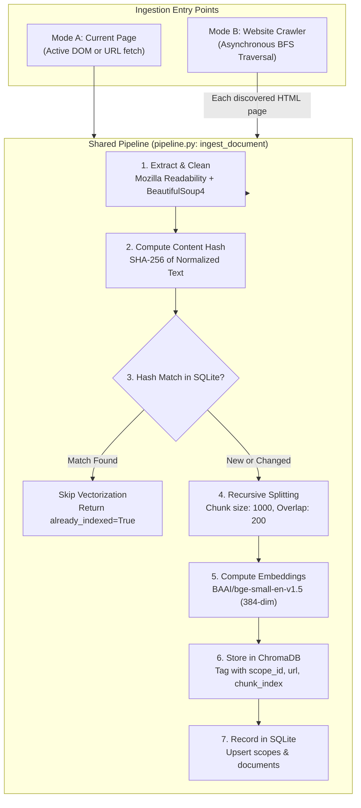
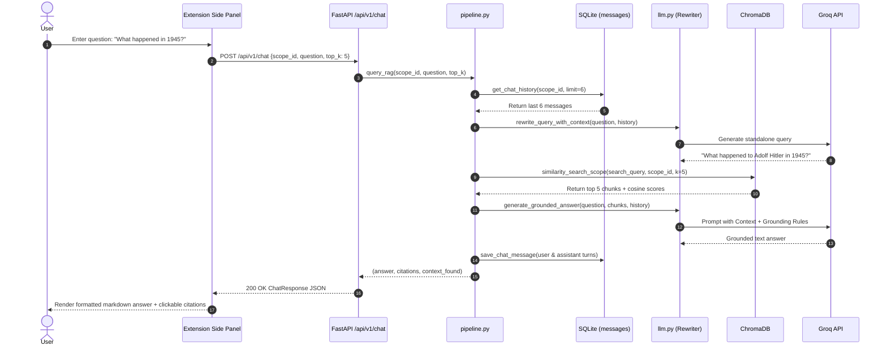
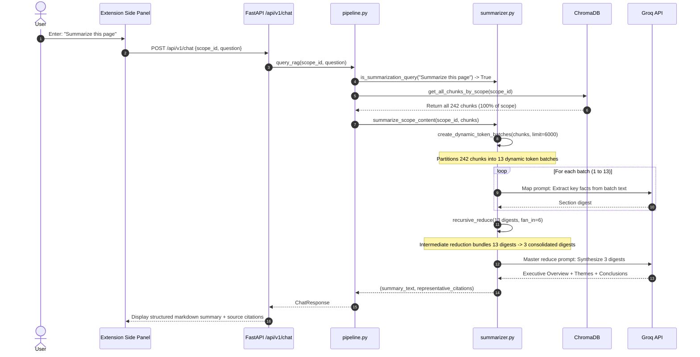

# WebRAG System Architecture

WebRAG is a browser-native retrieval-augmented generation (RAG) assistant. It allows users to index either the active browser webpage or an entire website via bounded web crawling, and then query the indexed corpus using natural-language questions through a Chrome Side Panel. All answers are strictly grounded in retrieved evidence and accompanied by clickable source citations.

---

## 1. System Topology

The system comprises two decoupled tiers:

1. **Client Tier (Chrome Extension)**: A Manifest V3 extension featuring a content script for DOM extraction, a background service worker for lifecycle management, and a React 19 side-panel interface.
2. **Server Tier (FastAPI Backend)**: A Python asynchronous backend coordinating document processing, vector search via ChromaDB, metadata persistence via SQLite, and LLM orchestration via Groq.

```mermaid
graph TB
    subgraph Browser ["Client: Chrome Extension (Manifest V3)"]
        ActiveTab["Active Webpage DOM"]
        CS["Content Script (content-script.ts)"]
        SW["Service Worker (service-worker.ts)"]
        UI["Side Panel UI (React 19 + Tailwind)"]
        ClientAPI["API Client (Axios/Fetch)"]

        ActiveTab -->|DOM extraction| CS
        CS -->|Message Passing| SW
        SW -->|Events| UI
        UI --> ClientAPI
    end

    subgraph Backend ["Server: FastAPI Backend (127.0.0.1:8000)"]
        API["FastAPI Endpoints (main.py)"]
        Crawler["Bounded Crawler (crawler.py)"]
        Pipeline["Ingestion & RAG Pipeline (pipeline.py)"]
        Extractor["Extractor & Normalizer (extractor.py)"]
        Chunker["Recursive Chunker (chunker.py)"]
        Budget["Token Budget Engine (token_budget.py)"]
        Summarizer["Hierarchical Summarizer (summarizer.py)"]
        LLM["Groq Resilient Engine (llm.py)"]
        Embeddings["Embedding Model (embeddings.py)"]
        VStore["Vector Store (vectorstore.py)"]
        DB["SQLite Manager (database.py)"]

        ClientAPI -->|HTTP REST| API
        API -->|Page Ingestion| Pipeline
        API -->|Site Crawl (Background)| Crawler
        Crawler -->|Each Extracted Page| Pipeline
        API -->|Chat & Summary| Pipeline

        Pipeline --> Extractor
        Extractor --> Chunker
        Chunker --> Embeddings
        Embeddings --> VStore
        Pipeline --> DB

        Pipeline --> Summarizer
        Pipeline --> LLM
        LLM --> Budget
    end

    subgraph Storage ["Persistent Local Storage"]
        ChromaData[("ChromaDB Storage\n./data/chroma")]
        SQLiteData[("SQLite Database\n./data/webrag.db")]
    end

    subgraph External ["External Services"]
        HuggingFace["HuggingFace Hub\n(BAAI/bge-small-en-v1.5)"]
        GroqPrimary["Groq Cloud Primary\n(openai/gpt-oss-120b)"]
        GroqFallback["Groq Cloud Fallback\n(openai/gpt-oss-20b)"]
    end

    VStore <--> ChromaData
    DB <--> SQLiteData
    Embeddings -.->|Weights Download| HuggingFace
    LLM -->|Primary API Calls| GroqPrimary
    LLM -.->|Failover on Model Error| GroqFallback
```

---

## 2. Chrome Extension Architecture

The extension is designed around Chrome's Manifest V3 architecture, using the Side Panel API for a non-intrusive workspace alongside the user's browsing tab.

### Manifest V3 Configuration

The extension manifest ([`extension/public/manifest.json`](file:///home/epsilon/Projects/webRAG/extension/public/manifest.json)) establishes strict security and capability boundaries:

* **Permissions**:
  * `sidePanel`: Opens the React assistant within the browser's native side panel.
  * `activeTab`: Provides temporary script execution and DOM access rights to the active tab upon user action.
  * `scripting`: Dynamically executes content extraction scripts.
  * `tabs`: Queries tab metadata (URL, tab ID, window ID) to maintain session synchronization.
* **Host Permissions**: `http://*/*` and `https://*/*` allow content inspection across standard web origins.
* **Content Security Policy (CSP)**: `script-src 'self'; object-src 'self'` prevents external script injection.

### Extension Subsystems

1. **Content Script (`extension/src/content/content-script.ts`)**:
   * Clones `document.body` in memory to prevent DOM disruption.
   * Strips non-content elements (`script`, `style`, `noscript`, `iframe`, `nav`, `footer`, `aside`, ads, comments).
   * Identifies semantic containers (`main`, `article`, `[role="main"]`).
   * Extracts clean article text, document title, and headings ($H_1$ to $H_3$).
   * Captures raw outer HTML for backend fallback parsing.
2. **Background Service Worker (`extension/src/background/service-worker.ts`)**:
   * Registers `chrome.sidePanel.setPanelBehavior` to open on action clicks.
   * Coordinates inter-component message passing between the content script and side panel.
3. **React Side Panel UI (`extension/src/sidepanel/`)**:
   * Built with React 19, TypeScript, and Tailwind CSS.
   * **Scope Selector**: Displays the active scope, indexed document count, and chunk counts. Allows switching scopes or purging scope data.
   * **Indexing Panel**: Provides two tabs:
     * *Current Page*: Extracts active DOM and pushes to the backend.
     * *Entire Website*: Configures crawl depth (1–3), page limits (5–50), and concurrency (1–4), with live job progress polling.
   * **Chat View**: Conversational interface with markdown formatting, query submission, and expandable citation drawer.

---

## 3. FastAPI Backend Architecture

The server is built with FastAPI (Python 3.14) and structured around modular service boundaries:

```
backend/
├── app/
│   ├── config.py         # Dynamic environment and settings management
│   ├── database.py       # SQLite connection pooling, tables, and CRUD operations
│   ├── schemas.py        # Pydantic v2 request/response schemas
│   ├── extractor.py      # Content cleaning, Readability parsing, SHA-256 hashing
│   ├── chunker.py        # RecursiveCharacterTextSplitter and chunk packaging
│   ├── embeddings.py     # HuggingFace sentence-transformers integration
│   ├── vectorstore.py    # Persistent ChromaDB vector operations and filtering
│   ├── crawler.py        # Asynchronous bounded crawler with SSRF protection
│   ├── token_budget.py   # Tokenizer-aware budget engine (tiktoken BPE)
│   ├── summarizer.py     # Dynamic token-batching map-reduce summarizer
│   ├── llm.py            # Groq API client with HTTP 429 backoff and fallback
│   ├── pipeline.py       # Central ingestion, query, and summarization pipeline
│   └── main.py           # FastAPI application, CORS, and endpoint controllers
├── tests/                # Automated pytest suite (34 unit and integration tests)
├── requirements.txt      # Production Python dependencies
└── run.py                # Standalone startup runner
```

### Application Lifecycle

On startup ([`backend/app/main.py`](file:///home/epsilon/Projects/webRAG/backend/app/main.py)), the application:
1. Initializes SQLite tables in `./data/webrag.db`.
2. Warms up the ChromaDB client in `./data/chroma`.
3. Pre-loads the `BAAI/bge-small-en-v1.5` sentence-transformer model onto CPU/GPU to eliminate cold-start latency on the first ingestion request.

---

## 4. Shared Downstream Ingestion Pipeline

A foundational design requirement of WebRAG is that **both single-page indexing and multi-page website crawling feed into the exact same downstream processing pipeline**.



### Rationale for a Unified Pipeline

* **Data Consistency**: Chunks from single pages and crawled sites share identical metadata schemas (`scope_id`, `source_url`, `page_title`, `chunk_index`, `content_hash`).
* **Deterministic Deduplication**: If an updated page is ingested, old chunks for that specific URL are purged from ChromaDB and replaced with newly chunked content without disturbing other pages in the same site scope.
* **Maintenance & Extensibility**: Text cleaning rules, splitting parameters, and embedding models are maintained in a single place.

---

## 5. Storage Architecture

WebRAG uses two complementary local storage systems:

| Storage Engine | Location | Responsibility | Schema / Format |
| :--- | :--- | :--- | :--- |
| **SQLite3** | `./data/webrag.db` | Relational metadata, crawl jobs, content hashes, conversation history | 4 tables: `scopes`, `documents`, `crawl_jobs`, `messages` |
| **ChromaDB** | `./data/chroma` | Dense vector index and document chunks | Single collection: `webrag_chunks` (Cosine metric, HNSW index) |

*For complete schema specifications, see [DATABASE_DESIGN.md](DATABASE_DESIGN.md).*

---

## 6. End-to-End Execution Flows

### A. Document Query Flow



### B. Whole-Document Summarization Flow



---

## 7. Model Resilience and Fault Tolerance

WebRAG incorporates a multi-layer resilience model:

1. **Tokenizer-Aware Budgeting**: Prompts are measured using `tiktoken` BPE tokenization prior to dispatch. Context and conversation history are budgeted against a maximum safe limit ($122,880$ tokens), leaving a $4,096$-token safety margin below the $131,072$-token context window.
2. **HTTP 429 Handling**: Rate-limit errors from Groq trigger automated exponential backoff with jitter and dynamic parsing of the `Retry-After` response header. Rate limits are **never** routed to the fallback model, preserving quota isolation.
3. **Automated Model Failover**: On genuine model failures (HTTP 404 model not found, HTTP 500/502/503 service outages), the engine switches from the primary model (`openai/gpt-oss-120b`) to the fallback model (`openai/gpt-oss-20b`).
4. **Credential Redaction**: All error logs pass through a sanitizer that strips `gsk_[a-zA-Z0-9_\-]+` strings before recording or returning messages.
