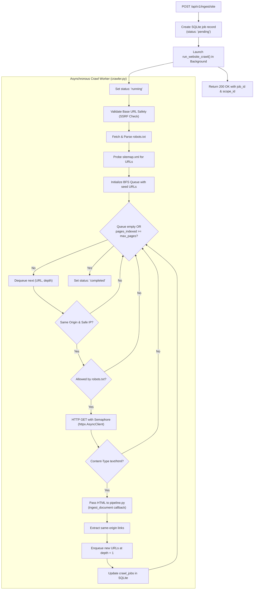

# WebRAG Crawler Specification

WebRAG includes a bounded, asynchronous web crawler ([`backend/app/crawler.py`](file:///home/epsilon/Projects/webRAG/backend/app/crawler.py)) designed to discover, fetch, and ingest website documentation trees into the RAG pipeline.

---

## 1. Crawl Architecture & Lifecycle

The crawler executes as a background task managed by FastAPI's `BackgroundTasks`, decoupling long-running multi-page crawls from synchronous HTTP requests.



---

## 2. Security Guardrails

### A. SSRF & Private IP Protection

Every discovered URL is validated through `validate_url_safety(url)` before dispatching network requests:

1. **Protocol Restriction**: Only `http` and `https` schemes are allowed. Schemes like `file://`, `ftp://`, `gopher://`, or `data:` are immediately rejected.
2. **DNS Resolution & IP Inspection**: Resolves hostnames to IP addresses via `socket.getaddrinfo`.
3. **Restricted IP Filtering**: Blocks all non-public IPv4 and IPv6 address ranges:
   * Loopback: `127.0.0.0/8`, `::1`
   * Private RFC 1918: `10.0.0.0/8`, `172.16.0.0/12`, `192.168.0.0/16`
   * Link-local & Cloud Metadata: `169.254.0.0/16` (protects AWS/GCP instance metadata endpoints `169.254.169.254`), `fe80::/10`
   * Unique Local Addresses (ULA): `fc00::/7`
4. **Localhost Override**: Local IP checking can be relaxed for automated development tests by setting `ALLOW_LOCALHOST=true` in `backend/.env`.

### B. Same-Origin Boundary

The crawler strictly restricts traversal to the exact origin (`scheme + netloc`) of the seed URL:

```python
base_netloc = urlparse(base_url).netloc.lower()
if urlparse(target_url).netloc.lower() != base_netloc:
    # Skip external or sub-domain link
    continue
```

Subdomains (e.g. `blog.example.com` vs `docs.example.com`) are treated as separate origins.

### C. Robots.txt Compliance

The crawler retrieves `{origin}/robots.txt` upon initialization using Python's `urllib.robotparser.RobotFileParser`. It identifies itself using the standard user agent:

```text
User-Agent: WebRAG-Crawler/1.0 (+https://github.com/adityaraj868/webRAG)
```

If a path is marked `Disallow:` for this agent or `*`, the crawler skips the URL and logs the restriction.

---

## 3. URL Discovery & Normalization

### Sitemap Discovery

Before crawling HTML links, the worker probes:

$$\text{sitemap\_url} = \text{base\_url} + \text{"/sitemap.xml"}$$

If a valid XML document is returned:
1. XML `<loc>` tags are extracted.
2. Discovered links matching the same origin are prioritized at `depth = 1`.

### HTML Link Extraction

For every fetched HTML document, BeautifulSoup parses all `<a href="...">` anchors:
1. Resolves relative paths against the current document URL using `urllib.parse.urljoin`.
2. Normalizes the resulting URL:
   * Strips URL fragments (`#section`).
   * Strips tracking parameters (`utm_*`, `ref`).
   * Removes trailing slashes to avoid duplicate canonical URLs (`/docs` vs `/docs/`).
   * Lowercases the protocol and hostname.

---

## 4. Concurrency & Rate Control

To prevent target server exhaustion, crawling is regulated by three parameters:

| Parameter | Default | Range | Description |
| :--- | :--- | :--- | :--- |
| **`max_pages`** | `10` | $1 \text{ to } 100$ | Maximum total pages to fetch and index |
| **`max_depth`** | `2` | $1 \text{ to } 5$ | Maximum link hops away from the seed URL |
| **`concurrency`** | `2` | $1 \text{ to } 4$ | Maximum simultaneous HTTP GET requests |
| **`timeout`** | `10.0`s | Fixed | Maximum duration per single HTTP GET request |

Concurrency is enforced via an `asyncio.Semaphore(concurrency)` wrapping an `httpx.AsyncClient` session.

---

## 5. Job Status Tracking

Crawl state is persisted in the SQLite `crawl_jobs` table and exposed via `GET /api/v1/ingest/status/{job_id}`:

```json
{
  "job_id": "job_a1b2c3d4e5f6",
  "scope_id": "scope_site_example_com",
  "status": "running",
  "pages_crawled": 8,
  "pages_indexed": 7,
  "total_chunks": 48,
  "pages_failed": 1,
  "current_url": "https://example.com/docs/api",
  "error": null
}
```

### State Transitions

```
[pending] ──> [running] ──> [completed]
                   │
                   └──> [failed] (on fatal base URL error)
```

---

## 6. Known Limitations

* **No Headless Browser Rendering**: The crawler uses HTTP requests (`httpx`), not a headless browser. Single Page Applications (SPAs) that require client-side JavaScript execution to render content will return empty HTML shells.
  > **Recommended Alternative**: For JavaScript-heavy SPAs, use the Chrome Extension's **Current Page** indexing mode, which extracts the already-rendered DOM directly from the browser tab.
* **No PDF / Binary Parsing**: Non-HTML MIME types (`application/pdf`, images, media) are filtered out and skipped.
