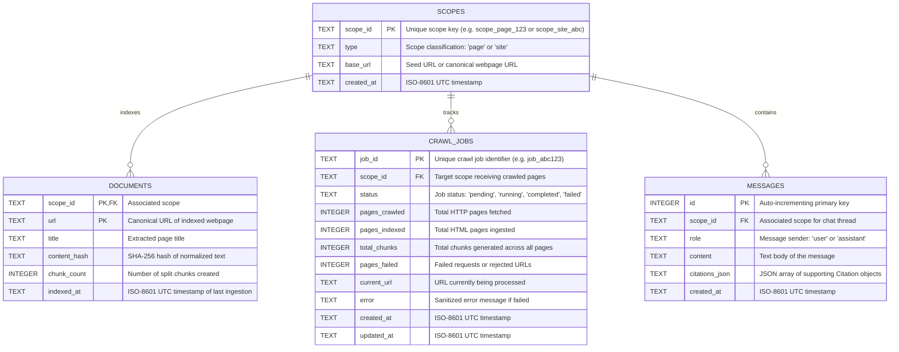

# WebRAG Database Design

WebRAG uses a dual-engine storage architecture:
1. **SQLite (`./data/webrag.db`)**: Manages structured relational entities, crawl job progress, deduplication hashes, and conversational chat history.
2. **ChromaDB (`./data/chroma`)**: Manages dense 384-dimensional vector embeddings and document chunk text indexed via Hierarchical Navigable Small World (HNSW) graphs.

---

## 1. Entity-Relationship Model



---

## 2. SQLite Schema Details

SQLite initialization is managed by [`backend/app/database.py`](file:///home/epsilon/Projects/webRAG/backend/app/database.py). Foreign keys are enforced via `PRAGMA foreign_keys = ON`.

### `scopes` Table
Defines an indexing boundary (either a single webpage or an entire website crawl).

```sql
CREATE TABLE IF NOT EXISTS scopes (
    scope_id TEXT PRIMARY KEY,
    type TEXT NOT NULL,                  -- 'page' or 'site'
    base_url TEXT NOT NULL,
    created_at TEXT NOT NULL
);
```

### `documents` Table
Maintains records for every individual webpage ingested. The compound primary key `(scope_id, url)` allows the same URL to be indexed in distinct scopes independently.

```sql
CREATE TABLE IF NOT EXISTS documents (
    scope_id TEXT NOT NULL,
    url TEXT NOT NULL,
    title TEXT,
    content_hash TEXT NOT NULL,         -- SHA-256 for deduplication
    chunk_count INTEGER NOT NULL,
    indexed_at TEXT NOT NULL,
    PRIMARY KEY (scope_id, url),
    FOREIGN KEY (scope_id) REFERENCES scopes(scope_id) ON DELETE CASCADE
);
```

### `crawl_jobs` Table
Stores asynchronous crawler job progress, metrics, and error state.

```sql
CREATE TABLE IF NOT EXISTS crawl_jobs (
    job_id TEXT PRIMARY KEY,
    scope_id TEXT NOT NULL,
    status TEXT NOT NULL,               -- 'pending', 'running', 'completed', 'failed'
    pages_crawled INTEGER DEFAULT 0,
    pages_indexed INTEGER DEFAULT 0,
    total_chunks INTEGER DEFAULT 0,
    pages_failed INTEGER DEFAULT 0,
    current_url TEXT,
    error TEXT,
    created_at TEXT NOT NULL,
    updated_at TEXT NOT NULL,
    FOREIGN KEY (scope_id) REFERENCES scopes(scope_id) ON DELETE CASCADE
);
```

### `messages` Table
Maintains conversational history strictly per scope. Chat history is stored in SQLite rather than ChromaDB to prevent vector index pollution.

```sql
CREATE TABLE IF NOT EXISTS messages (
    id INTEGER PRIMARY KEY AUTOINCREMENT,
    scope_id TEXT NOT NULL,
    role TEXT NOT NULL,                 -- 'user' or 'assistant'
    content TEXT NOT NULL,
    citations_json TEXT,                -- Serialized JSON array of citations
    created_at TEXT NOT NULL,
    FOREIGN KEY (scope_id) REFERENCES scopes(scope_id) ON DELETE CASCADE
);

CREATE INDEX IF NOT EXISTS idx_messages_scope ON messages(scope_id);
```

#### Chronological History Retrieval Query
To ensure that conversation history retrieval supplies the **most recent** turns while preserving chronological order ($t_0 \to t_1 \to t_2$), `get_chat_history()` executes an inverted subquery:

```sql
SELECT role, content, citations_json, created_at
FROM (
    SELECT id, role, content, citations_json, created_at
    FROM messages
    WHERE scope_id = ?
    ORDER BY id DESC
    LIMIT ?
)
ORDER BY id ASC;
```

---

## 3. ChromaDB Vector Store Design

ChromaDB is used as an embedded, persistent vector store located at `./data/chroma`.

### Collection Specifications

* **Collection Name**: `webrag_chunks`
* **Embedding Model**: `BAAI/bge-small-en-v1.5`
* **Dimensionality**: **384 floats**
* **Index Metric**: **Cosine similarity** (`{"hnsw:space": "cosine"}`)
* **Index Configuration**: Default HNSW parameters (`ef_construction = 100`, `M = 16`).

### Chunk Document Structure

For each chunk stored in ChromaDB:
* **`id`**: Formatted composite ID: `{scope_id}_{chunk_index}_{short_hash}`.
* **`document`**: The raw chunk text (up to 1,000 characters).
* **`metadata`**:
  ```json
  {
    "scope_id": "scope_site_example",
    "source_url": "https://example.com/docs/intro",
    "page_title": "Introduction - Example Docs",
    "chunk_index": 0,
    "content_hash": "a1b2c3d4..."
  }
  ```

---

## 4. Scope Deletion & Purge Behavior

When `DELETE /api/v1/scopes/{scope_id}` is invoked:

1. **Vector Purge**:
   ```python
   collection.delete(where={"scope_id": scope_id})
   ```
   ChromaDB deletes all vector embeddings and chunk texts matching the scope ID.
2. **Relational Cascade**:
   In SQLite, records are deleted in dependency order:
   ```sql
   DELETE FROM messages WHERE scope_id = ?;
   DELETE FROM documents WHERE scope_id = ?;
   DELETE FROM crawl_jobs WHERE scope_id = ?;
   DELETE FROM scopes WHERE scope_id = ?;
   ```
3. **Guaranteed Cleanup**: No orphaned vectors or conversation threads remain after a scope is purged.
