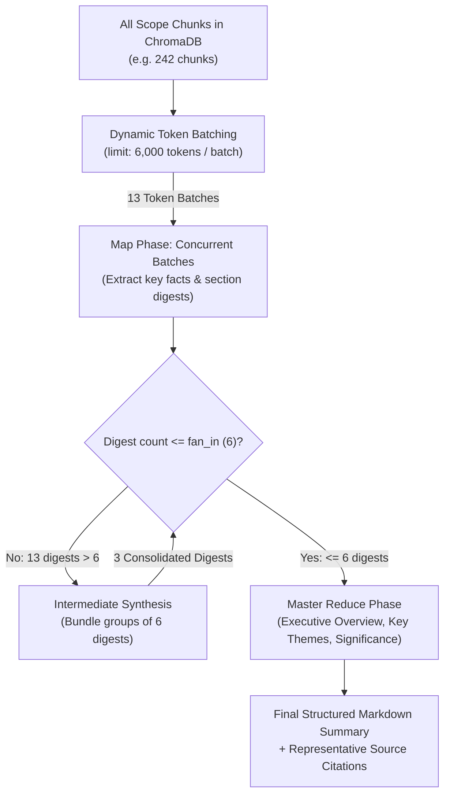

# WebRAG Pipeline Specification

This document details the internal design, mathematical conventions, and configuration parameters of WebRAG's unified Retrieval-Augmented Generation (RAG) pipeline.

---

## 1. Document Extraction and Normalization

Raw HTML and webpage text are processed by [`backend/app/extractor.py`](file:///home/epsilon/Projects/webRAG/backend/app/extractor.py).

### Extraction Hierarchy

1. **Mozilla Readability (`readability-lxml`)**: Identifies the primary content container, stripping surrounding navigation, sidebars, footers, headers, and advertisement frames.
2. **BeautifulSoup4 Sanitization**: Parses Readability's clean HTML tree. Non-content tags (`script`, `style`, `noscript`, `iframe`, `svg`, `nav`, `aside`, `form`) are stripped.
3. **Semantic Fallback**: If Readability yields fewer than 100 characters (e.g. dynamic SPAs or fragmented layouts), BeautifulSoup extracts directly from `main`, `article`, or `body`.
4. **Heading Extraction**: Captures all $H_1$, $H_2$, and $H_3$ headers to build a structural outline.

### Text Normalization

The normalization function (`normalize_text`):
* Unescapes HTML entities (`&amp;` $\to$ `&`, `&quot;` $\to$ `"`).
* Standardizes unicode punctuation (curly quotes $\to$ straight quotes, em-dashes $\to$ hyphens).
* Collapses runs of spaces and horizontal whitespace into single spaces.
* Replaces three or more consecutive line breaks with double newlines (`\n\n`), preserving clean paragraph boundaries while eliminating vertical whitespace padding.

---

## 2. Recursive Text Splitting

Text chunking is performed by [`backend/app/chunker.py`](file:///home/epsilon/Projects/webRAG/backend/app/chunker.py) using LangChain's `RecursiveCharacterTextSplitter`.

### Splitting Parameters

| Parameter | Config Name | Default Value | Notes |
| :--- | :--- | :--- | :--- |
| **Chunk Size** | `CHUNK_SIZE` | `1000` | Measured in **characters** ($200 \text{ to } 250$ tokens) |
| **Chunk Overlap** | `CHUNK_OVERLAP` | `200` | Measured in **characters** ($40 \text{ to } 50$ tokens) |
| **Separators** | Hardcoded | `["\n\n", "\n", ". ", " ", ""]` | Tries natural paragraphs first, then sentences, then words |
| **Length Function** | Hardcoded | `len` | Character-level measurement |

### Chunk Metadata Packaging

Every resulting chunk is wrapped in a LangChain `Document` object populated with structured metadata:

```python
{
    "scope_id": scope_id,              # Scope identifier (page or site)
    "source_url": document_url,        # Canonical URL of the parent webpage
    "page_title": page_title,          # Webpage or document title
    "chunk_index": idx,                # 0-indexed integer position within the document
    "content_hash": sha256_hash        # SHA-256 hash of the parent document content
}
```

---

## 3. Content Hashing and Deduplication

To eliminate redundant vector computations, WebRAG calculates a SHA-256 hash over normalized document text before chunking:

$$\text{content\_hash} = \text{SHA256}(\text{normalized\_text})$$

### Deduplication Logic ([`backend/app/pipeline.py`](file:///home/epsilon/Projects/webRAG/backend/app/pipeline.py))

1. The pipeline queries SQLite (`documents` table) for existing records matching `(scope_id, url)`.
2. **If hash matches existing record**: Re-embedding is bypassed entirely. The response immediately returns `already_indexed = True`, eliminating embedding compute and ChromaDB write I/O.
3. **If content has changed**:
   - Stale chunks for `(scope_id, url)` are deleted from ChromaDB.
   - The document is re-split and re-embedded.
   - The updated hash and chunk count are recorded in SQLite.

---

## 4. Dense Embeddings & Vector Indexing

Embeddings are managed by [`backend/app/embeddings.py`](file:///home/epsilon/Projects/webRAG/backend/app/embeddings.py) and stored via [`backend/app/vectorstore.py`](file:///home/epsilon/Projects/webRAG/backend/app/vectorstore.py).

### Embedding Specifications

* **Model**: `BAAI/bge-small-en-v1.5`
* **Architecture**: HuggingFace Sentence Transformers (BERT-based)
* **Embedding Dimension**: **384 dimensions**
* **Context Length**: 512 tokens
* **Device**: Automatically uses GPU if CUDA is available, otherwise CPU.

### Vector Storage Engine

* **Engine**: ChromaDB (`PersistentClient`)
* **Persistence Directory**: `./data/chroma` (configurable via `CHROMA_PERSIST_DIR`)
* **Collection Name**: `webrag_chunks`
* **Distance Metric**: **Cosine distance** (`{"hnsw:space": "cosine"}`)
* **Relevance Conversion**:
  ChromaDB returns cosine distance $d \in [0, 2]$. WebRAG converts this to similarity score $s$:

  $$s = 1.0 - d$$

---

## 5. Similarity Retrieval & Scope Isolation

Retrieval queries are executed by `similarity_search_scope()` in `vectorstore.py`:

```python
results = collection.query(
    query_texts=[query],
    n_results=k,
    where={"scope_id": scope_id}
)
```

### Strict Scope Isolation

* **Isolation Guarantee**: The metadata filter `where={"scope_id": scope_id}` is enforced at the database index level.
* **No Cross-Contamination**: Documents indexed in `scope_page_abc` can never be retrieved when querying `scope_site_xyz`, even if their semantic distance to the query is near zero.

---

## 6. Contextual Query Rewriting

Users in conversational sessions frequently submit follow-up questions containing pronouns or elided references (e.g. *"Who was he?"*, *"Explain the second point"*, *"What happened in 1945?"*). Vector similarity search against raw pronouns produces poor retrieval results.

WebRAG uses [`rewrite_query_with_context`](file:///home/epsilon/Projects/webRAG/backend/app/llm.py) to resolve coreferences:

1. **Trigger Condition**: Activated if the query contains coreference terms (`he`, `she`, `it`, `they`, `this`, `that`, `second`, `next`, `why`, etc.) or is shorter than 6 words.
2. **Context Window**: Loads the last 4 turns from SQLite chat history.
3. **Execution**: Uses Groq to transform ambiguous follow-ups into standalone search queries containing specific names, entities, and subjects before performing ChromaDB vector retrieval.

---

## 7. Token-Budget Management

WebRAG implements strict tokenizer-aware budgeting in [`backend/app/token_budget.py`](file:///home/epsilon/Projects/webRAG/backend/app/token_budget.py) using `tiktoken` BPE tokenization (`cl100k_base`).

### Budget Calculation

The maximum allowable prompt size is computed dynamically:

$$\text{Max Input Budget} = \text{MODEL\_CONTEXT\_WINDOW} - \text{SAFETY\_MARGIN\_TOKENS} - \text{EXPECTED\_COMPLETION\_TOKENS}$$

Using production defaults:
* $\text{MODEL\_CONTEXT\_WINDOW} = 131,072$ tokens
* $\text{SAFETY\_MARGIN\_TOKENS} = 4,096$ tokens
* $\text{EXPECTED\_COMPLETION\_TOKENS} = 4,096$ tokens
* **Maximum Safe Input Tokens**: **$122,880$ tokens**

### Dynamic Prompt Allocation (`fit_context_within_budget`)

When assembling a chat prompt, tokens are allocated hierarchically:
1. **Fixed Overhead**: System prompt ($\approx 150$ tokens) + User question ($\approx 30\text{--}100$ tokens) + Framing ($\approx 100$ tokens).
2. **Conversation History**: Allocated up to $\min(2000, 20\% \text{ of available tokens})$. Prioritizes the most recent turns moving backwards in time.
3. **Retrieved Context**: The remaining budget is allocated to context chunks in order of cosine similarity. If the final chunk partially exceeds the budget, it is safely truncated.

---

## 8. Grounded Answer Generation & Citations

Answer generation is governed by strict anti-hallucination guardrails in [`backend/app/llm.py`](file:///home/epsilon/Projects/webRAG/backend/app/llm.py).

### System Prompt & Grounding Rules

```text
You are WebRAG, a precise and factual AI assistant. Your job is to answer questions strictly and exclusively based on the provided website excerpts below.

CRITICAL INSTRUCTIONS:
1. Grounding: Answer ONLY using facts directly mentioned in the CONTEXT. Do not use outside knowledge or extrapolate beyond the text.
2. Insufficient Information: If the provided context does not contain enough facts to answer the question, state clearly and concisely: "I cannot answer this question based on the indexed content, as the context does not provide sufficient information on this topic."
3. Accuracy: Never fabricate facts, statistics, or source references.
4. Neutral tone: Be direct, clear, and informative. Use markdown formatting where appropriate (bullet points, bold text).
```

### Citation Card Structure

For every retrieved chunk used in answering, a `Citation` object is returned to the client:

```json
{
  "source_url": "https://en.wikipedia.org/wiki/Adolf_Hitler",
  "page_title": "Adolf Hitler - Wikipedia",
  "chunk_index": 42,
  "content_excerpt": "Hitler was appointed chancellor on 30 January 1933 following the...",
  "relevance_score": 0.884
}
```

The extension renders clickable links that open the source URL in a new tab.

---

## 9. Hierarchical Map-Reduce Summarization

When a user submits a summarization intent (e.g. *"Summarize"*, *"Give me an overview"*), standard top-5 similarity search fails because single-word queries do not match factual sentences in the corpus.

WebRAG uses [`backend/app/summarizer.py`](file:///home/epsilon/Projects/webRAG/backend/app/summarizer.py) for whole-document and website summarization:



### Key Summarization Properties

1. **100% Scope Coverage**: Bypasses vector math; uses `get_all_chunks_by_scope()` to load every chunk belonging to the scope.
2. **Dynamic Token Batching**: Chunks are measured with `tiktoken` BPE and grouped up to `SUMMARIZATION_BATCH_TOKEN_LIMIT` (default 6,000 tokens). Eliminates arbitrary batch ceilings.
3. **No Silent Truncation**: Full chunk text is passed through the map prompts without length clipping.
4. **Failure Accounting**: Tracks and reports `processed_chunk_ids` versus `failed_chunk_ids`.
5. **Representative Citations**: Employs an index-sampling algorithm spanning the beginning, middle, quartiles, and end of the document, as well as the first chunk of each unique URL.
6. **Rate-Limit Resilience**: Incorporates pacing pauses (`SUMMARIZATION_RATE_DELAY = 0.2s`) and automatic backoff on HTTP 429 errors.
